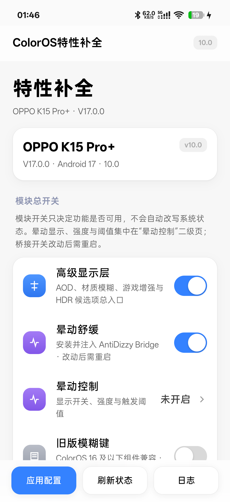
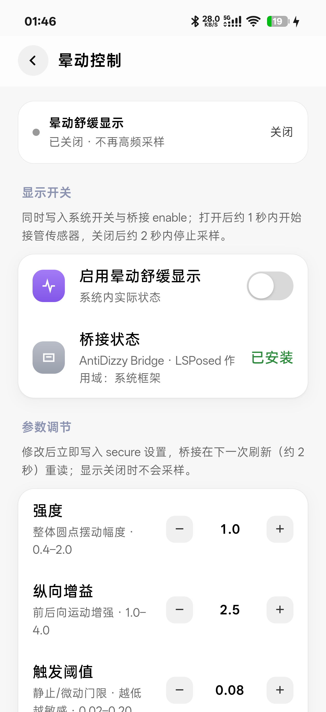

# ColorOS特性补全

> KernelSU 模块：动画与模糊、AOD、手势、游戏显示增强，以及晕动舒缓桥接。
>
> 作者：三重 / 酷安@MieAi
>
> 当前版本：`10.1.1`（versionCode `1002`）

## 简介

面向 **ColorOS 16 / 17** 的显示与动效补全模块。它不修改系统分区，也不做机型伪装；能力通过启动属性、运行时 Settings 写入和 WebUI 开关实现，卸载或重启后可恢复。

10.0 的重点是晕动舒缓：桥接改为秒级响应系统开关，WebUI 新增“晕动控制”二级页，可调强度、纵向增益和触发阈值。模块本身只提供功能入口，默认不主动打开任何显示项。

10.1 的重点是 **机型适配**：新增运行时能力探测，按当前 ColorOS 16/17 实际存在的 Settings 键与 PQ 属性决定写不写、显不显示；WebUI 增加“适配策略”卡片，可切换自动 / 兼容 / 全量，未声明支持的项显示为不可用，兼容模式下隐藏实验项。

10.1.1 是 10.1 的门户校验修复版：`module.prop` 的 `versionCode` 改为 KernelSU 规范键名，解决门户同步报 `prop-missing-field`；功能与 10.1 相同。

## 机型适配

- **自动**：ColorOS 17 且检测到材质模糊与全屏 AOD 键时按全量；其余按兼容。默认策略。
- **兼容**：只应用 ColorOS 16/17 的稳定项；实验项强制为 0，不创建系统没有的 Settings/PQ 键。
- **全量**：显示全部项；物理不支持的项仍然禁用、不写入。
- 支持的判断依据是 `settings list` / `settings get`、`getprop` 与桥接包是否安装，不靠机型名硬编码。
- `system.prop` 不再强制声明媒体面板模糊、AOD 硬件支持，也不再关闭“模糊昂贵”提示；这些能力交给系统按硬件自行判断，避免低配机掉帧或出现不可用入口。

## 界面预览

<p align="center">
  
  
</p>

<p align="center"><sub>左：主页 · 右：晕动控制二级页（10.0 截图；10.1 在设备卡下方新增适配策略卡片）</sub></p>

## 功能

| 模块 | 内容 |
|---|---|
| 动画与模糊 | 动画档位、壁纸动画、SurfaceFlinger 背景模糊、音量条模糊、小窗模糊快照、材质模糊与桌面壁纸模糊 |
| AOD 与锁屏 | 全屏 AOD、锁屏充电动画、AOD 工坊 |
| 手势 | 侧滑返回跟手 |
| 游戏与显示 | 游戏 MEMC、游戏色彩增强、HDR10+ adaptive |
| 晕动舒缓 | 原厂 AntiDizzy 圆点渲染 + LSPosed 桥接；系统开关秒级响应，WebUI 二级页调参 |
| 实验功能 | 全天全景 AOD、HDR10/Vivid、视频超分、MML 色彩、AI SDR→HDR，默认关闭 |
| 护眼 | 阅读模式手动开关 |

常驻动画与模糊属性在开机阶段由 `system.prop` 写入；其余项目由 `advanced.sh` 在开机或点“应用配置”时写入 Settings。带“需重启”标记的改动在重启后生效。

## 晕动控制

主页“模块总开关”里的“晕动舒缓”只负责安装桥接并提供功能入口；实际显示开关和参数在“晕动控制”二级页：

- **显示开关**：同时写入系统开关与桥接 `enable`。打开后约 1 秒内接管传感器，关闭后约 2 秒内停止采样。
- **强度**：整体圆点摆动幅度，范围 `0.4–2.0`。
- **纵向增益**：前后向运动增强，范围 `1.0–4.0`。
- **触发阈值**：静止/微动门限，越低越敏感，范围 `0.02–0.20`。
- **预设**：柔和 `0.7 / 1.6 / 0.12`，标准 `1.0 / 2.5 / 0.08`，强效 `1.4 / 3.2 / 0.05`。
- **恢复默认**：把三项参数写回标准值，不改变显示开关。

参数写入系统 secure 设置，桥接约 2 秒内重读；显示关闭时不会采样。

## 安装

环境要求：

- ColorOS 16 / 17（Android 16 / 17）
- KernelSU 或兼容 KernelSU 模块格式的 root 管理器
- 晕动功能另需 LSPosed

步骤：

1. 从 [Releases](https://github.com/MieAiiii/ColorOS_fullpower/releases) 下载最新模块 zip。
2. 在 KernelSU 管理器中安装并重启。
3. 打开模块 WebUI，按需开启“高级显示层”和各子项。
4. 如需晕动舒缓：在主页开启“晕动舒缓”，重启；在 LSPosed 中启用 `AntiDizzy Bridge`，作用域勾选“系统框架”，再次重启。
5. 进入“晕动控制”二级页，打开显示开关并按需调参。

> 从 9.x 升级到 10.0 时，桥接 APK 已更换签名。若开机日志提示 `bridge: update failed`，说明旧桥接无法覆盖安装：请先卸载旧的 `AntiDizzy Bridge`，再安装模块内的 `files/AntiDizzyBridge.apk`，在 LSPosed 重新勾选作用域后重启。

## 使用建议

- 晕动参数从“标准”开始；眩晕未缓解先提高强度或纵向增益，画面晃眼则降低。
- 触发阈值越低越容易触发，静止场景可能出现轻微漂移；日常建议 `0.08` 左右。
- 实验功能是否生效取决于屏幕硬件和当前 ColorOS 版本，没有可见变化属于正常。
- 阅读模式只做手动写入，不参与开机自动应用。

## 配置与目录

配置文件：`/data/adb/modules/coloros_fullpower/config.conf`

常用键：

| 键 | 默认 | 说明 |
|---|---|---|
| `ADAPT_MODE` | `auto` | 适配策略：`auto` / `compat` / `full` |
| `ENABLE_ADVANCED` | `1` | 高级显示层总开关 |
| `ENABLE_ANTIDIZZY` | `1` | 安装并启用晕动桥接；实际显示另由二级页控制 |
| `ENABLE_LEGACY` | `0` | ColorOS 16 及以下旧版模糊键 |
| `ENABLE_FULL_AOD` | `1` | 全屏 AOD |
| `ENABLE_AOD_CHARGE` | `1` | 锁屏充电动画 |
| `ENABLE_AOD_WORKSHOP` | `1` | AOD 工坊 |
| `ENABLE_ALL_DAY_AOD` | `0` | 全天全景 AOD，耗电/烧屏风险 |
| `ENABLE_DESKTOP_BLUR` | `1` | 桌面壁纸模糊 |
| `ENABLE_MATERIAL_BLUR` | `1` | 材质模糊 |
| `ENABLE_MATERIAL_STROKE` | `1` | 材质描边 |
| `ENABLE_FOLLOW_HAND` | `1` | 侧滑跟手 |
| `ENABLE_GAME_MEMC` | `1` | 游戏 MEMC |
| `ENABLE_GAME_COLOR` | `1` | 游戏色彩增强 |
| `ENABLE_HDR10P_ADAPTIVE` | `1` | HDR10+ adaptive |
| `ENABLE_HDR10_ADAPTIVE` | `0` | HDR10 adaptive 实验项 |
| `ENABLE_HDRVIVID_ADAPTIVE` | `0` | HDR Vivid adaptive 实验项 |
| `ENABLE_ULTRA_RESOLUTION` | `0` | 视频超分实验项 |
| `ENABLE_MML_COLOR_ADAPTIVE` | `0` | MML 色彩自适应实验项 |
| `ENABLE_AI_SDR_ADAPTIVE` | `0` | AI SDR→HDR 实验项 |

目录结构：

```text
src/                    模块源码（打包内容）
├── module.prop
├── system.prop
├── customize.sh
├── post-fs-data.sh
├── service.sh
├── advanced.sh
├── cleanup.sh
├── uninstall.sh
├── webroot/
│   ├── index.html
│   ├── theme.css
│   ├── adapt.sh
│   └── ctl.sh
└── files/AntiDizzyBridge.apk
module.yaml             KernelSU 收录元数据
.github/workflows/release.yml
tools/validate_webui.py WebUI 结构校验
tools/adapt_mock_test.sh 能力探测/写入 mock 回归
```

## 恢复

- 关闭对应开关并点“应用配置”，可撤销运行时 Settings 写入。
- 关闭“高级显示层”会停止后续 Settings 写入；已经写入的键需要卸载模块或手动改回系统设置才能恢复。
- 卸载模块并重启，会清理桥接、晕动开关、临时文件与模块写入项；常驻属性随模块移除恢复。
- 晕动参数保存在 secure 设置中，卸载时由 `cleanup.sh` 清理。

## 常见问题

**WebUI 提示“未检测到 KernelSU 执行接口”**`n必须从 KernelSU 管理器 → 模块 → 本模块 → 打开进入；普通浏览器没有 `ksu.exec`。

**晕动开关打开但画面没有变化**`n按顺序检查：LSPosed 是否启用 `AntiDizzy Bridge`、作用域是否勾选“系统框架”、是否重启、桥接日志是否有 `settings observer registered` / `ready`。只安装 APK 不会生效。

**升级后晕动不是秒级响应**`n说明新签名桥接没有覆盖安装成功。按上方升级说明卸载旧桥接、安装模块内 APK，并在 LSPosed 重新启用作用域。

**实验功能打开后没有效果**`n这些键依赖屏幕硬件与当前系统版本，本机未声明支持时不会产生可见变化。保持默认关闭即可。

## 构建与发布

GitHub Actions 在推送 `v*` tag 时从 `src/` 打包单个 zip，并创建 Release。Release 只包含一个模块 zip，桥接 APK 已包含在内。

本地校验：

```bash
python tools/validate_webui.py
bash tools/adapt_mock_test.sh
```

`adapt_mock_test.sh` 用 mock 的 `getprop` / `settings` / `pm` 覆盖三套环境：ColorOS 17 全量、ColorOS 16 精简、ColorOS 17 残缺；检查 `ADAPT_EFFECTIVE`、`SUP_*`、只写存在的键、兼容模式隐藏/归零实验项。10.1 发布前手机已断开，未做真机复测；真机表现以实际机型为准。

## 致谢

- 晕动舒缓上游：[MieAiiii/oplus-antidizzy-module](https://github.com/MieAiiii/oplus-antidizzy-module)（MIT License）
- 作者：三重 / 酷安@MieAi

## 免责声明

本项目修改系统运行时设置与显示属性，使用前请确认自己的机型、系统版本与恢复方式。因其他模块冲突、系统升级或误操作导致的异常，请先卸载模块并重启；作者不承担由此产生的直接或间接损失。
