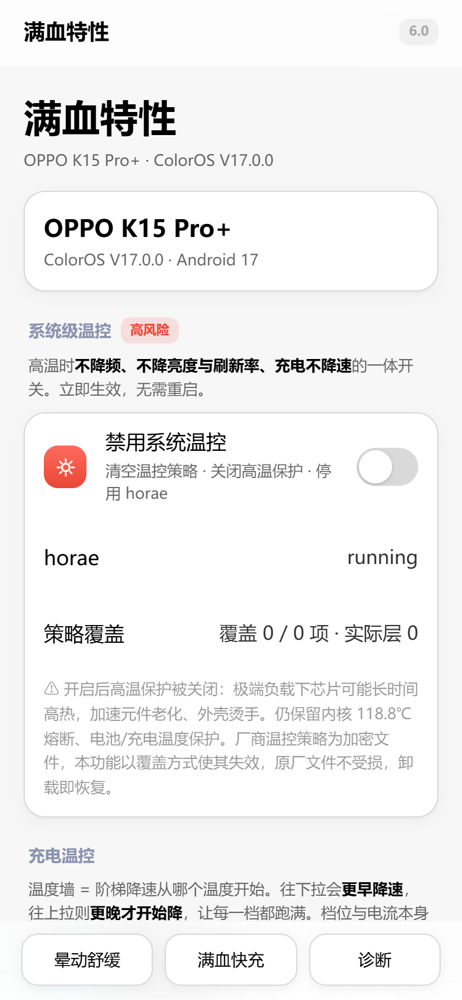
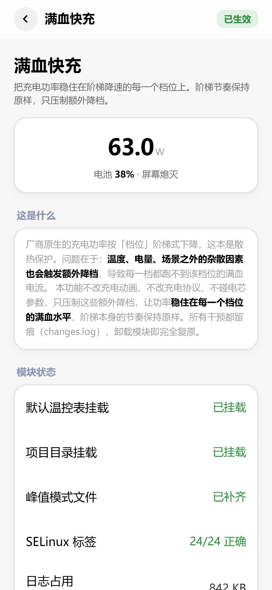
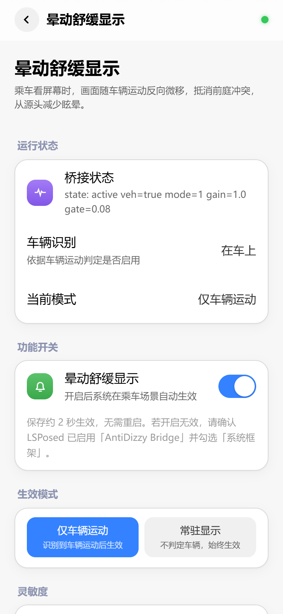

# ColorOS 满血特性

> KernelSU 模块：动画/模糊、机型特性补齐、自适应满血快充、系统温控管理、晕动舒缓显示。
>
> 作者：三重 / 酷安@MieAi
>
> 当前版本：`6.0.2`（versionCode `602`）

## 简介

这是一个面向 **ColorOS 16 / 17** 的 KernelSU 模块。它不修改系统分区，也不做机型伪装；能用的能力通过属性、bind mount 和模块 WebUI 实现，卸载或重启后自动恢复。

模块最初合并了两条独立工作流：

- 满血充电：fastchg 温控表叠加 + `peak` 息屏满充守护
- 晕动舒缓：原厂圆点 UI + LSPosed 桥接 APK。该功能来源于 [MieAiiii/oplus-antidizzy-module](https://github.com/MieAiiii/oplus-antidizzy-module)（MIT License）；本仓库负责集成、统一 WebUI 和参数桥接

6.0 起，快充部分不再写死 `25061 / 8000mA / 53℃ / PMG110` 等机型参数，改为在刷入/开机时读取本机快充表并生成对应温度墙。

## 界面预览

以下截图是模块 WebUI 的三个主要页面。截图使用演示数据，实际数值以当前机型和充电状态为准。

<p align="center">
  <a href="docs/images/webui-home.png"></a>
  <a href="docs/images/webui-charge.png"></a>
  <a href="docs/images/webui-dizzy.png"></a>
</p>

从 KernelSU 管理器进入模块 WebUI 后：主页先确认机型、系统版本和温度墙；点底部「满血快充」确认挂载状态；点「晕动舒缓」检查 LSPosed 桥接和车辆识别。

<p align="center"><sub>左：主页 · 中：满血快充 · 右：晕动舒缓</sub></p>

## 功能

| 功能 | 说明 |
|---|---|
| 动画与模糊 | 写入 ColorOS 动画档位、壁纸动画、SurfaceFlinger 背景模糊、音量条模糊、小窗模糊快照等属性 |
| 机型特性补齐 | 根据本机系统版本/机型，补齐相机、音频、录屏等可选特性键；不强行覆盖系统已有值 |
| 自适应满血快充 | 开机扫描实际 `fastchg` 固件根，读取 `PROJECT`、协议段、峰值电流、表内最高温度，生成温度墙表并 bind mount |
| 温度墙 | 自动墙按本机表峰值电流最后出现的温度 + 5..21℃ 抬升；上限由本机表最高温推导，不写死 53℃ |
| peak 满充守护 | 息屏后按 `TARGET_SOC` 清除充电限流/降流标志，记录满充 CSV；使用 `setsid` 守护，避免被 KernelSU `service.sh` 退出时带走 |
| 系统级温控 | 可选关闭用户态温控策略（`tempctl on`）；关闭时卸载本模块自己的层并恢复 `horae` 等温控服务 |
| 晕动舒缓显示 | 原厂 AntiDizzy 圆点渲染 + LSPosed 桥接；功能来源于 [MieAiiii/oplus-antidizzy-module](https://github.com/MieAiiii/oplus-antidizzy-module)；由 `ENABLE_ANTIDIZZY` 控制 |
| WebUI | Miuix / HyperOS 风格单文件 WebUI；温度墙滑块上限、快充项目、电流等信息均来自本机 `profile.env` |

## 原理

### 1. 自适应快充与温度墙

开机 `post-fs-data.sh` 调用 `bin/tempwall.sh prepare`：

1. 扫描候选根：`/odm/firmware/fastchg`、`/odm/etc/firmware/fastchg`、`/vendor/firmware/fastchg`、`/vendor/etc/firmware/fastchg`、`/my_odm/firmware/fastchg`、`/my_product/firmware/fastchg`、`/product/firmware/fastchg`、`/system_ext/firmware/fastchg`。
2. 从本机 `charging_thermal_config_default*.txt` 与项目目录下的 `*hyper_mode_config.txt` 解析 `*_THERMAL_CONTROL` 协议段。
3. 计算：
   - `MAX_CURRENT`：表内最大电流
   - `MAX_TEMP`：峰值电流最后出现的温度
   - `MAX_TABLE_TEMP`：表内所有协议段最高温度
   - `WALL_MAX = min(580, MAX_TABLE_TEMP + 110)`（0.1℃ 单位）
   - `DEFAULT_WALL`：以峰值电流最后温度 + 5..21℃ 抬升，夹到 `440..WALL_MAX`
   - `TABLE_LADDER_MAX = min(580, MAX_TABLE_TEMP + 160)`：低电流档梯度上限
4. 用 `bin/tablegen.awk` 生成同结构表，只改温度、不改电流值和协议段顺序。
5. 将生成表 bind mount 到真实 fastchg 路径；原厂表首次读到后缓存在 `/data/adb/coloros_fullpower/orig`，并用路径、md5、目录签名和 ROM 版本防止跨根/热更新污染。

实测 OPPO K15 Pro+（PMG110，ColorOS V17.0.0）得到：

```text
PROJECT=25061  MAX_CURRENT=8000  MAX_TEMP=320  MAX_TABLE_TEMP=420
WALL_MAX=530   DEFAULT_WALL=530  TABLE_LADDER_MAX=580
```

对伪造的 `LOW01 / 6000mA / 370` 表，模块得到 `WALL_MAX=480 / wall=480 / ladder_max=530`，说明不再固定使用 25061 的参数。

### 2. peak 满充守护

`bin/peak.sh` 在息屏后按配置轮询电池状态；当达到 `TARGET_SOC` 时清理 `cool_down`、`normal_cool_down`、`slow_chg_en`、`chg_up_limit`、`mmi_charging_enable` 等充电限流标志。`restore` 会把首次快照写回。守护进程通过 `setsid` 逃出 `service.sh` 的进程组，并通过 `/proc/<pid>/cmdline` 校验 PID，避免 PID 复用误判。

### 3. 系统温控恢复

`bin/tempctl.sh on` 用 bind mount 覆盖用户态温控策略文件，并停止 `horae`；`off` 只卸载本模块自己的层，然后：

- 将 `persist.sys.horae.enable` 恢复为 `1`
- 拉起 `horae` 并等待到 `running`
- 将 `thermal-engine` 按可用性处理
- 修正旧的 `0/stopped` 快照，避免“关闭去除温控后 horae 仍然 stopped”

`post-fs-data.sh` 与 `service.sh` 在 `ENABLE_SYSTHERMAL=0` 时都会执行一次恢复，覆盖开机时 state 为空的情况。

### 4. 晕动舒缓

本项目的晕动舒缓显示能力来源于 [MieAiiii/oplus-antidizzy-module](https://github.com/MieAiiii/oplus-antidizzy-module)（MIT License）。上游项目负责原厂 AntiDizzy 特性的补全与 LSPosed 桥接；本仓库负责把它集成进 ColorOS 满血特性模块，提供统一 WebUI、参数持久化和开关控制。

`files/AntiDizzyBridge.apk` 提供 LSPosed 桥接；模块通过特性声明与 Settings 写入启用原厂 AntiDizzy 圆点。默认 `ENABLE_ANTIDIZZY=0`，需要在 WebUI 开启并在 LSPosed 中启用模块、勾选系统框架后重启。上游项目更新时，可以单独替换 `files/AntiDizzyBridge.apk` 后重新刷入。

## 安装与使用

### 环境

- ColorOS 16 / 17（Android 16 / 17）
- KernelSU（或兼容 KernelSU 模块格式的 root 管理器）
- 已解锁 Bootloader、刷入可用的 KernelSU 内核

### 安装

1. 从 [Releases](https://github.com/MieAiiii/ColorOS_fullpower/releases) 下载最新 `ColorOS_fullpower_v*.zip`。
2. 在 KernelSU 管理器中安装模块，重启。
3. 打开模块 WebUI，确认快充状态为 `supported=1`，检查项目号、协议段、温度墙是否符合本机表。
4. 如需晕动舒缓，在 WebUI 开启 `ENABLE_ANTIDIZZY`，在 LSPosed 中启用 `AntiDizzy Bridge` 并勾选系统框架，重启。

### 快速上手（按页面）

#### 1. 主页：先确认设备与温度墙

1. 从 KernelSU 管理器 → 模块 → 本模块 → 打开 WebUI。普通浏览器没有 KernelSU 执行接口，会提示“未检测到执行接口”。
2. 顶部设备卡应显示本机型号和 ColorOS 版本；如果显示“未知设备”，先不要改快充参数。
3. “系统级温控”默认关闭。它是高风险开关，只建议在跑分、高温或明确需要时临时打开；日常保持关闭。
4. “充电温控”里的当前温度墙来自本机 `profile.env`，不是固定 53℃。先看“适配信息”的项目号、电流和协议段数，再决定是否手动调整。
5. 动画与模糊、功能补齐按需开关；这些键写入 `config.conf`，改动后重启生效。

#### 2. 满血快充：先看“已生效”，再看功率

1. 点底部“满血快充”。右上角状态应为绿色“已生效”；显示“未识别”或“部分生效”时先排查，不要直接拉温度墙。
2. “模块状态”里确认默认温控表、项目目录、峰值模式文件都已挂载/补齐，SELinux 标签显示“24/24 正确”。
3. “当前策略”应显示本机项目号、协议段数、满血电流、降档起点和生效表大小。以 K15 Pro+ 为例会是 `25061 · 9 段`、`8000 mA`、`53.0 ℃`。
4. “峰值保持”打开后，守护进程会在到达目标电量前压制额外降档；目标电量可在 60–100% 之间调整，默认 100%。守护状态显示“守护中”即正常。
5. “实时充电”里重点看电池电流、电池电压、适配器输入、电池温度和 `fast_chg_type`；`cool_down=0` 表示当前没有额外降档标志。
6. 想看真实峰值，请拔掉电脑 USB，接原装 80W SuperVOOC 充电器，并从较低电量开始、保持息屏。电脑 USB 只有 5V/0.5A，不能用来判断快充是否生效；80% 以后电流下降也属于正常后段。

#### 3. 晕动舒缓：LSPosed 是前提

1. 先在主页打开“晕动舒缓显示”（`ENABLE_ANTIDIZZY=1`），重启。
2. 在 LSPosed 中启用 `AntiDizzy Bridge`，作用域勾选“系统框架”，再次重启。只装 APK 不启用作用域不会生效。
3. 打开“晕动舒缓”页，确认“桥接状态”有 `state: active`，车辆识别显示“在车上”或“未检测到车辆”。
4. 模式建议先用“仅车辆运动”，只有识别到车辆运动才生效；需要持续演示时再切“常驻显示”。
5. 灵敏度推荐起点：摆动幅度 `1.0×`、前后向增强 `2.5×`、静止门限 `0.08`。眩晕未消先加摆动幅度；画面晃眼则降低。
6. “测试”里的正弦摆动、车辆运动、模拟走路等只用于验证，看完记得切回“关闭测试”。
7. 如果开关打开但画面没有变化，按顺序检查：LSPosed 是否启用桥接、是否勾选系统框架、是否重启、桥接日志是否有 `state: active`。上游实现与更新见 [MieAiiii/oplus-antidizzy-module](https://github.com/MieAiiii/oplus-antidizzy-module)。

#### 4. 诊断与恢复

- “诊断 → 开机日志”可以查看本次开机的写入、挂载与跳过明细。
- 关闭“快充表叠加”并重启，可撤销快充表的运行时挂载；彻底回原厂可卸载模块后重启。
- 晕动参数保存在系统 secure 设置，卸载模块时会随模块清理逻辑恢复；卸载前建议先在 WebUI 记下自己改过的值。

### 常用配置

配置文件位于 `/data/adb/modules/coloros_fullpower/config.conf`：

| 键 | 默认 | 说明 |
|---|---|---|
| `ENABLE_PEAK` | `1` | 是否启用快充表叠加与 peak 守护 |
| `TEMP_WALL` | `0` | `0` 为按本机表自动；手动范围 `440..WALL_MAX`（0.1℃） |
| `ENABLE_SYSTHERMAL` | `0` | 是否关闭系统用户态温控；高风险，默认关闭 |
| `ENABLE_ANTIDIZZY` | `0` | 是否启用晕动舒缓 |
| `ENABLE_CAMERA` / `ENABLE_AUDIO` / `ENABLE_RECORDER` | `1` | 可选特性补齐 |
| `ENABLE_LEGACY` | `0` | 旧版兼容键 |

WebUI 中的温度墙滑块上限来自本机 `profile.env` 的 `wall_max`，不是固定 53℃。

## 注意事项

1. **不是所有 ColorOS 16/17 机型都保证可用**。模块会按实际表结构探测；找不到 `*_THERMAL_CONTROL` 协议段或没有可用 fastchg 根时会跳过快充叠加，不会硬改未知表。
2. **不要与其他 fastchg 温控模块同时使用**。同路径多模块 bind mount 会发生顶层互踩，温度墙可能随机变化。
3. **系统温控开关是高风险的**。关闭用户态温控后，极端场景下设备可能长时间高热；内核温控 trip 仍然存在，但用户态降频/降亮策略会被清空。默认 `ENABLE_SYSTHERMAL=0`。
4. **模块不修改系统分区**。挂载是运行时 bind mount；卸载/重启会恢复。若系统 OTA 或恢复出厂，请先卸载模块。
5. **温度墙不要盲目拉满**。自动墙根据本机表峰值电流与表最高温推导；手动值上限为 `WALL_MAX`，不是固定 53℃ 或 58℃。
6. **晕动舒缓依赖 LSPosed**。仅安装 APK 不会生效；需要在 LSPosed 中启用并勾选系统框架。
7. **备份**。首次安装会保留 `backup/original_backup.txt`；升级会继承已有 config，不覆盖原始备份。
8. **测试环境**。本项目主要在 OPPO K15 Pro+（PMG110 / ColorOS V17.0.0 / Android 17）验证；其他机型请先看 WebUI 的 `supported / project / wall_max / max_current` 再决定是否开启。

## 常见问题

### WebUI 提示“未检测到 KernelSU 执行接口”

必须从 KernelSU 管理器 → 模块 → 本模块 → 打开进入。直接用浏览器打开 `index.html` 不会注入 `ksu.exec`，只能看到演示数据。

### 快充页显示“未识别”或“部分生效”

先确认模块已刷入并重启；再看“模块状态”的默认表、项目目录、峰值模式文件和 SELinux 标签。若本机没有 `*_THERMAL_CONTROL` 段，模块会跳过快充叠加而不是硬改未知表。不要同时安装其他 fastchg 温控模块，同路径 bind mount 会互踩。

### 显示“已生效”但充电很慢

先看供电条件：电脑 USB 口通常只有 5V/0.5A，不能作为快充测试；需要原装 80W SuperVOOC 充电器。电量高于 80% 后进入恒压后段，电流下降是正常的。若低电量、息屏、原装充电器下仍然很慢，再到“实时充电”看 `fast_chg_type`、`cool_down` 和电池温度，判断是协议未识别、额外降档还是温度墙先触发。

### 晕动舒缓开关打开但无效果

按顺序检查：LSPosed 是否启用 `AntiDizzy Bridge`、作用域是否勾选“系统框架”、是否重启、晕动页“桥接状态”是否有 `state: active`。只安装 APK 不会生效。实现来源与更新见 [MieAiiii/oplus-antidizzy-module](https://github.com/MieAiiii/oplus-antidizzy-module)。

### 温度墙上限为什么不是固定的 53℃

53℃ 只是 K15 Pro+（项目 `25061`）当前表推导出的值。其他机型会按本机峰值电流最后出现的温度和表内最高温计算 `WALL_MAX`；WebUI 滑块上限随之变化，不要照抄别机的数值。

## 更新日志

### v6.0.1（2026-11-20）

- 为满足 KernelSU 收录要求，在仓库开启 Release immutability 后重新发布
- 模块功能与 v6.0 相同，仅将 `versionCode` 提升到 `601`，确保新 Release 为不可变资产
- Release 继续只包含一个模块 zip，APK 已包含在 zip 内

### v6.0（2026-11-20）

- 快充参数全自适应：fastchg 根、`PROJECT`、协议段、峰值电流、表最高温均开机读取，不再写死 `25061 / 8000mA / 53℃ / PMG110`
- 温度墙 `WALL_MAX` 由本机表最高温推导；手动范围动态为 `440..WALL_MAX`
- 低电流梯度上限按本机表推导，25061 保持原有 580 表现
- `ORIG` 缓存增加路径、文件 md5、目录签名和 ROM 版本校验，修复跨根/热更新污染
- SELinux 上下文改为显式 `ls -Z + chcon`，不再依赖 toybox 不支持的 `--reference`
- 每个 mount 目标使用独立 payload，修复多个空文件共用 inode 导致上下文被最后一次 `chcon` 覆盖
- 系统温控恢复原始 `horae` 属性/服务状态，并修复旧 `0/stopped` 快照导致关闭后 horae 仍然 stopped 的问题
- 开机/`service.sh` 在 `ENABLE_SYSTHERMAL=0` 时都会确认恢复 `horae`
- peak 守护改用 `setsid` 逃逸 `service.sh` 进程组；PID 校验改为读取 `/proc/<pid>/cmdline`
- APK 按 sha256 比较后升级，不再只在缺失时安装
- WebUI 温度墙滑块上限动态读取 `wall_max`，修复 `twMax=440` 时的除零问题
- 兼容更多 fastchg 候选根：新增 `/vendor/etc`、`/my_product`、`/product`、`/system_ext`

### v5.0

- 单文件 WebUI（主页 / 快充 / 设置三页）
- 合并满血核心静态温控等价物
- 全部 UI 按 Miuix 规范重写
- 卸载清理 APK、Settings、特性声明层和临时文件

## 目录结构

```text
src/                    模块源码（打包内容）
├── module.prop
├── system.prop
├── customize.sh
├── post-fs-data.sh
├── service.sh
├── cleanup.sh
├── uninstall.sh
├── bin/
│   ├── peak.sh
│   ├── tempwall.sh
│   ├── tempctl.sh
│   ├── tablegen.awk
│   └── cap.sh
├── webroot/
│   ├── index.html
│   ├── theme.css
│   └── status.sh
└── files/AntiDizzyBridge.apk
module.yaml             KernelSU 收录元数据
.github/workflows/release.yml
TECHNICAL_REPORT.md     详细技术档案
tools/validate_webui.py WebUI 结构校验
docs/images/            README 界面截图
```

## 构建与发布

仓库使用 GitHub Actions：推送 `v*` tag 时从 `src/` 打包出单个 zip 并创建 Release。Release 只包含一个模块 zip，APK 已包含在 zip 内。

本地校验：

```bash
python tools/validate_webui.py
```

## 致谢

- 原满血充电工作流：`息屏快充修复`
- 晕动舒缓：[MieAiiii/oplus-antidizzy-module](https://github.com/MieAiiii/oplus-antidizzy-module)（MIT License）
- 作者：三重 / 酷安@MieAi

## 免责声明

本项目仅供个人学习与设备自定义使用。刷入模块、关闭系统温控、修改充电策略均可能带来过热、电池损耗、系统不稳定等风险；请自行评估并承担后果。请勿用于商业分发或违反所在地法律法规的用途。
